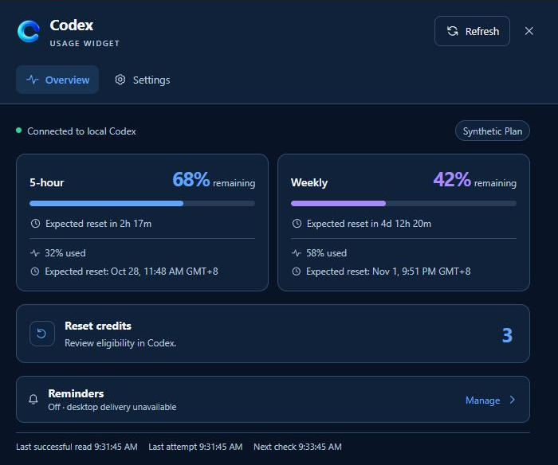
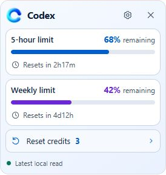
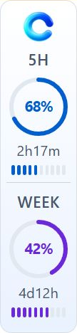
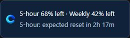

# Codex Usage Widget

Keep Codex remaining quota and expected reset times in view on your Windows desktop. Choose a floating card, screen-edge widget, compact HUD, or system tray summary, with usage read through your local Codex CLI.

**[Download v0.1.2 for Windows x64](https://github.com/andali89/codex-usage-widget-app/releases/tag/v0.1.2)** · [Release notes](docs/v0.1.2-release-notes.md) · [Documentation](docs/README.md)

An unofficial project, not affiliated with or endorsed by OpenAI. Version 0.1.2 is a public preview; see [known limitations](#known-limitations).

Development version: **0.1.3 (unreleased)**. See the [0.1.3 release notes](docs/v0.1.3-release-notes.md) for the current widget sizing and spacing changes.

## Download and install

Choose a download from the [v0.1.2 release](https://github.com/andali89/codex-usage-widget-app/releases/tag/v0.1.2):

| Download | Use |
| --- | --- |
| [Windows installer](https://github.com/andali89/codex-usage-widget-app/releases/download/v0.1.2/Codex.Usage.Widget_0.1.2_x64-setup.exe) | Run the setup executable to install for your Windows account. |
| [Portable ZIP](https://github.com/andali89/codex-usage-widget-app/releases/download/v0.1.2/Codex.Usage.Widget_0.1.2_x64-portable.zip) | Extract the entire ZIP into a writable folder and run `codex-usage-widget.exe`. |
| [SHA-256 checksums](https://github.com/andali89/codex-usage-widget-app/releases/download/v0.1.2/SHA256SUMS.txt) | Verify the installer and portable archive. |

Requirements:

- **Windows x64.** Windows 10 and 11 are targets; runtime validation to date is on Windows 11.
- **Microsoft Edge WebView2 Runtime 120 or newer.** The installer can offer a download if needed; the portable ZIP requires an existing runtime.
- **A separately installed, signed-in native Codex CLI** with a supported ChatGPT account context.

After installation, open the widget and choose a display mode in Settings or the tray menu. If automatic Codex discovery fails, set the full native `codex.exe` path in **Settings → Connection & diagnostics**. Authentication stays with Codex.

GitHub's **Source code** ZIP/TAR archives are for building the project, not running the application.

## Screenshots

These screenshots use synthetic example data; they do not show a real account.

**Overview dashboard**



| Floating | Screen Edge |
| --- | --- |
|  |  |

| Compact HUD | System Tray hover |
| --- | --- |
|  |  |

## Features

| Mode | Display |
| --- | --- |
| Floating | Movable card with quota bars, reset countdowns, and available reset credits. |
| Screen Edge | Percentage rings that dock to the nearest left or right screen edge after dragging. |
| System Tray | Background monitoring with a compact hover summary and dashboard access. |
| Compact HUD | Movable horizontal strip with quota values, bars, and optional countdowns. |

- View remaining quota, expected resets, data freshness, and reset-credit information when provided by Codex.
- Choose 5-hour, weekly, or both periods independently for Edge and HUD, with optional countdowns and word or badge labels. Set 2–12 remaining-time bars independently for each period and widget (default 10); Save applies the choices.
- Select Light, Dark, or Follow Windows appearance; configure position lock, always on top, and launch at sign-in.
- Choose Original or ten showcase-inspired paired Light/Dark themes, optionally customize quota colors from 24 or more named swatches plus the selected theme’s colors, and set one snap gap for Floating, Edge, and HUD (0–48 logical px; default 8). Appearance and gap edits temporarily update the active widget; Save keeps them and Cancel restores saved settings. Show widget border defaults to On and applies across themes, widget modes, and hover summaries; turning it off preserves widget dimensions and internal dividers. Widget backgrounds are currently opaque, and the transparency setting is hidden. Existing saved transparency values are retained but inactive. Windows high contrast keeps a visible border. See the [appearance and snapping report](docs/widget-appearance-and-snap-implementation-report.md).
- Set independent Edge and HUD sizes from **80% to 300%** without changing their layouts (default 100%), and optionally make their reset countdowns bold or use higher contrast text across all themes. Edits preview temporarily; Save keeps them and Cancel restores saved values. Oversized selections are rejected with the monitor’s fitting limit. A saved enlargement that later stops fitting temporarily falls back to 100% without changing its saved value.
- Configure an HTTP/HTTPS proxy without credentials for the widget's Codex process and choose EXE-adjacent, AppData, or custom configuration storage.

## Using the widget

- **Hover** over Edge, HUD, or the tray icon for a usage summary.
- **Single-click** a widget or tray icon for Overview; **double-click** opens the standard dashboard window.
- **Right-click** for the shared menu, including Settings, Hide/show, Reset position, and Quit.
- **Drag** Floating or HUD to move them. Drag Edge and release to dock it. Enable Lock position to prevent movement.
- Overview fits its content up to 85% of the monitor work-area height. Settings keeps those dimensions and scrolls. Manually resizing the standard dashboard preserves its session size; the single-click popup remains independent.
- Closing the dashboard keeps monitoring active. Floating's × switches to System Tray mode; **Quit** exits the application.

Missing or stale data is labeled explicitly. A countdown reaching zero does not confirm quota recovery; fresh usage data is required.

## Privacy and local data

Usage reads go through the local Codex app-server. The widget does not copy credential files, issue inference requests, or redeem reset credits. It adds no cloud telemetry or quota-upload service; Codex communicates with its own services as needed.

Settings and opaque reminder bookkeeping are stored locally, beside the executable by default. General settings offers AppData or a custom folder and shows the active location and any fallback warnings. Displayed quota values are not restored from disk across restarts.

Optional local diagnostic logging is **off by default**. Enable it in **Settings → Connection & diagnostics**, Save, and use **Open logs folder** to investigate loading/stale episodes and refresh timing. Logs are in `diagnostics/` beside the active configuration, capped at 5 MiB per folder with rotation. They exclude credentials, account identifiers, quota values and raw responses. Disabling retains existing logs; configuration moves leave earlier logs in their earlier folders. See the [diagnostic logging guide and validation report](docs/diagnostic-logging-implementation-report.md) for analysis commands and limitations.

## Known limitations

- **Windows notifications remain unresolved. Do not rely on reminder delivery.** See the [notification investigation](docs/notification-error-investigation.md).
- Builds are unsigned and may trigger Windows SmartScreen warnings.
- Windows 10, accessibility, mixed-DPI monitors, Explorer recovery, real pointer/focus behavior, and installation without WebView2 remain incompletely verified.
- Proxy settings reach the owned Codex process; actual traffic routing remains independently unverified.

The [implementation report](docs/implementation-report.md) records validation evidence and remaining work. The [design report](docs/codex-widget-design-report.md) describes intended behavior, including requirements still awaiting validation.

## Development

Built with **Tauri 2, Rust, React, TypeScript, Vite, and Tailwind CSS**. Use Windows with the MSVC x64 toolchain, Windows SDK, WebView2, and the Node/npm versions declared in [.node-version](.node-version) and [package.json](package.json).

Run from the repository root in PowerShell:

```powershell
npm.cmd ci
cargo fetch --manifest-path src-tauri/Cargo.toml --target x86_64-pc-windows-msvc --locked
npm.cmd run desktop:dev
```

Dependencies are pinned by the manifests and lockfiles. Tauri's CLI is project-local; no global npm installation is required. Reuse installed tooling and obtain confirmation before adding software or development tools.

For frontend development, run `npm.cmd run dev` and open `http://127.0.0.1:1420`. Browser mode has no native Codex connection. See the [contributor reference](docs/development-environment-setup.md#contributor-reference--2026-10-24) for the tested toolchain, synthetic presentation fixture, native checks, and installer smoke check.

### Check and build

```powershell
npm.cmd test
npm.cmd run build
npm.cmd run rust:fmt
npm.cmd run rust:check
npm.cmd run rust:test
npm.cmd run rust:clippy
npm.cmd run desktop:build
```

`build` includes frontend type checking. `desktop:build` produces `src-tauri/target/release/Usage.exe` without an installer. The default main binary is `Usage.exe` for debug, release and future packages; published v0.1.2 archives keep their original filename. To build the per-user NSIS installer, run `npm.cmd run desktop:package`; output is under `src-tauri/target/release/bundle/nsis/`.

Regular tests skip live Codex access. Run `npm.cmd run protocol:probe` explicitly for a live read-only check against the local signed-in CLI. Native tray, focus, DPI, notification, and accessibility behavior require Windows runtime checks; successful builds alone do not validate them.

The [Windows release workflow](.github/workflows/release.yml) builds an installer, portable ZIP, and checksums on pushes to `release`, then creates a draft prerelease for review. See the [release guide](docs/github-release-guide.md) for packaging and publication, and the [versioned protocol reference](schemas/codex/README.md) for schema provenance.

## Reporting issues

[Open an issue](https://github.com/andali89/codex-usage-widget-app/issues) with the app version, Windows version, reproduction steps, and expected versus observed behavior. Omit credentials, account identifiers, and private usage responses.

## License

Original code and documentation are licensed under the [MIT License](LICENSE), copyright © 2026 Anda Li H.

Third-party dependencies and materials retain their upstream terms, including the maintained [auto-launch patch](src-tauri/vendor/auto-launch/LICENSE) and [Codex schema references](schemas/codex/README.md). Artwork provenance is recorded in the [layout report](docs/layout-polish-implementation-report.md). Private design references are excluded from the repository. Review the applicable third-party notices when redistributing binaries.
